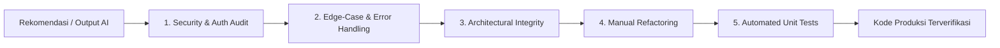

# AI Disclosure & Laporan Transparansi Penggunaan AI - Floranity

Dokumen ini merupakan bentuk kepatuhan transparansi akademik dan profesional terhadap pemanfaatan teknologi *Artificial Intelligence* (AI) selama siklus pengembangan perangkat lunak platform **Floranity**. 

Floranity memegang prinsip bahwa teknologi AI berfungsi semata-mata sebagai **akselerator produktivitas (*co-pilot*)**, sementara seluruh arsitektur sistem, pengambilan keputusan logika bisnis, penjaminan keamanan, evaluasi kritis, dan penulisan pengujian akhir tetap dikendalikan dan divalidasi penuh oleh tim pengembang manusia (*Human-in-the-Loop*).

---

## 1. Matriks Ringkasan Penggunaan AI Lintas Modul

| Bagian / Modul Sistem | Alat AI yang Digunakan | Tujuan Utama Pemanfaatan AI | Tingkat Kontribusi AI | Peran Validasi Pengembang Manusia |
| :--- | :--- | :--- | :--- | :--- |
| **Koleksi & Katalog Spesies** | GitHub Copilot, Claude 3.5 Sonnet | *Boilerplate* skema ORM, pemetaan filter katalog, mock data `sample_data.py` | ~30% Kode Awal | Perbaikan otorisasi akses kepemilikan, perancangan *caching* Perenual API, unit testing |
| **Jadwal & Log Perawatan** | ChatGPT (GPT-4o), GitHub Copilot | Perancangan enum choices, formula penyesuaian volume air, form input | ~25% Kode Awal | Restrukturisasi Foreign Key ke tanaman, penanganan kegagalan API cuaca, timezone audit |
| **Forum & Observasi Komunitas** | Claude 3.5 Sonnet, GitHub Copilot | Query agregasi interaksi (like/comment), drafting template HTML | ~25% Kode Awal | Migrasi ke interaksi asinkron HTMX, sanitasi XSS, perbaikan cascading relasi komentar |
| **Autentikasi & Profil Pengguna** | ChatGPT (GPT-4o), GitHub Copilot | Setup sinyal Django `post_save`, kalkulasi inisial avatar profil | ~20% Kode Awal | Pencegahan Open Redirect, hashing SHA-256 penghapusan akun, pengamanan upload media |
| **Infrastruktur & CI/CD Pipeline** | Claude 3.5 Sonnet, GitHub Copilot | *Template* GitHub Actions workflow, konfigurasi staticfiles Whitenoise | ~20% Kode Awal | Multi-version testing matrix (Python 3.12/3.13), konfigurasi CSRF PWS UI, isolasi env |

---

## 2. Rincian AI Disclosure untuk Setiap Modul

---

### A. Modul Manajemen Koleksi dan Katalog Spesies Tanaman (`koleksi`)

#### 1. Komponen & Bagian Fungsional
* **Sub-bagian Katalog Spesies Publik:** Penjelajahan database tanaman hias dengan fitur pencarian dan filter bertingkat (kebutuhan sinar matahari, frekuensi penyiraman, dan siklus hidup) yang terhubung ke Perenual API v2 serta penyediaan data cadangan (*fallback*).
* **Sub-bagian Koleksi Tanaman Pribadi:** Fungsionalitas CRUD (*Create, Read, Update, Delete*) tanaman yang dimiliki pengguna dengan isolasi data berbasis sesi autentikasi.
* **Sub-bagian Jurnal Pertumbuhan Kronologis:** Pencatatan riwayat perkembangan fisik dan galeri foto berkala untuk setiap spesimen tanaman.

#### 2. Alat AI yang Digunakan
* **GitHub Copilot:** Pelengkapan kode otomatis (*inline code completion*) pada penulisan struktur model dan forms Django.
* **Claude 3.5 Sonnet:** Perancangan skema relasi database dan penyusunan struktur data *mock* pada `sample_data.py`.
* **ChatGPT (GPT-4o):** Eksplorasi pemetaan query parameter Perenual API ke dalam tuple pilihan dropdown Django.

#### 3. Tujuan dan Bagaimana AI Membantu
* Menghasilkan rancangan awal model ORM Django `Tanaman` dan `JurnalPertumbuhan`.
* Membantu menyusun kamus penerjemahan istilah botani dari bahasa Inggris (standar API Perenual) ke bahasa Indonesia (seperti `TERJEMAHAN_CAHAYA` dan `PILIHAN_AIR`).
* Menyusun dataset contoh (*seed data*) sebanyak puluhan spesies tanaman hias lokal dan internasional untuk pengujian fungsionalitas ketika kuota API pihak ketiga sedang tidak tersedia.

#### 4. Strategi Prompting
* **Teknik Context-Primed & Constraint-Based Prompting:** Memberikan cuplikan contoh respons JSON dari Perenual API v2 beserta spesifikasi batas kuota paket gratis (maksimal 100 request/hari, ID spesies di atas 3000 berbayar), lalu meminta AI menghasilkan skema model dan struktur caching yang hemat request.
* **Contoh Prompt Aktual:**
  > *"Bertindaklah sebagai arsitek backend Django. Diberikan struktur JSON respons dari Perenual API berikut: [JSON sample]. Buatlah model Django `Tanaman` yang mencakup kebutuhan cahaya, penyiraman, dan tingkat kesulitan, serta fungsi service di `services.py` yang memfilter parameter query. Pastikan ada batasan penanganan ID di atas 3000 karena akun gratis tidak dapat mengaksesnya."*

#### 5. Analisis Kritis Keterbatasan AI (*Critical Breakdown of Limitations*)
* **Ketiadaan Mekanisme Caching Otomatis:** Kode awal yang dihasilkan AI melakukan *direct HTTP request* ke Perenual API setiap kali ada pengguna yang membuka halaman katalog. Jika diterapkan di lingkungan produksi, kuota harian Perenual API (100 request) akan habis dalam hitungan menit, melumpuhkan seluruh katalog tanaman.
* **Celah Broken Object-Level Authorization (BOLA):** Pada fungsi view `update` dan `delete`, kode yang disarankan AI hanya menyertakan dekorator `@login_required` dan langsung mengambil objek dengan `Tanaman.objects.get(pk=tanaman_id)`. AI lalai memeriksa kepemilikan data (`tanaman.pemilik == request.user`), sehingga membuka celah keamanan kritis di mana pengguna yang masuk dapat memodifikasi atau menghapus koleksi tanaman milik pengguna lain hanya dengan menebak parameter ID di URL.
* **Asumsi Penyimpanan Gambar Tidak Fleksibel:** AI menyarankan penggunaan `ImageField` standar tanpa memperhitungkan bahwa server hosting target (PWS Fasilkom UI) memiliki lingkungan *ephemeral container* tanpa persistent storage bawaan untuk media upload, yang berpotensi menyebabkan gambar hilang atau error upload.

#### 6. Perbaikan Manual oleh Pengembang (*Manual Fixes & Human Intervention*)
* **Implementasi Caching Berlapis:** Pengembang manusia mengimplementasikan modul `django.core.cache` secara manual pada `services.py` dengan TTL 3600 detik (`CACHE_DETIK = 60 * 60`), serta membangun sistem penanganan *fallback* otomatis ke `sample_data.py` jika API merespons dengan kode HTTP 429 (Rate Limit) atau terjadi `HTTPError` / `URLError`.
* **Pengamanan Akses Data (Otorisasi Ketat):** Pengembang menulis ulang *query logic* pada seluruh view koleksi dengan menyaring data secara ketat berdasarkan `pemilik=request.user`, serta membuat dekorator kustom pada `koleksi/decorators.py` untuk memastikan pengguna hanya dapat membaca dan memanipulasi tanamannya sendiri.
* **Penyusunan Suite Pengujian Otomatis:** Tim pengembang menyusun 14+ unit test komprehensif pada `koleksi/tests.py` untuk memvalidasi proteksi akses multi-user, pagination katalog, dan integritas data jurnal pertumbuhan.

---

### B. Modul Jadwal dan Log Perawatan Berbasis Cuaca (`journal`)

#### 1. Komponen & Bagian Fungsional
* **Sub-bagian Pencatatan Aktivitas Perawatan:** Sistem logging multi-aktivitas meliputi penyiraman (*watering*), pemupukan (*fertilizing*), pemangkasan (*pruning*), penggantian pot (*repotting*), dan pembaruan fase pertumbuhan.
* **Sub-bagian Evaluasi Status Kesehatan:** Indikator kondisi vital tanaman (*healthy*, *needs attention*, *recovering*) disertai tagging gejala spesifik (daun kuning, busuk akar, tunas baru).
* **Sub-bagian Integrasi Metrik Cuaca Mikro:** Sinkronisasi parameter lingkungan (suhu, persentase kelembaban udara, dan curah hujan harian) dari OpenWeather API untuk memberikan rekomendasi perawatan adaptif.

#### 2. Alat AI yang Digunakan
* **ChatGPT (GPT-4o):** Konseptualisasi enum pilihan teks (`TextChoices`) dan formula heuristik penyesuaian volume penyiraman berdasarkan suhu udara.
* **GitHub Copilot:** Pembuatan boilerplate form fields pada `journal/forms.py` dan serialisasi data model.

#### 3. Tujuan dan Bagaimana AI Membantu
* Menghasilkan struktur dasar model `JournalLog` menggunakan sintaks modern Django `models.TextChoices` untuk enumerasi tipe aktivitas dan status kesehatan.
* Memberikan referensi kalkulasi matematis sederhana dalam memperkirakan kebutuhan volume air (*milliliters*) berdasarkan kombinasi suhu dan kelembaban lingkungan.
* Membantu penataan struktur form input dengan atribut HTML5 (seperti tipe data numerik dengan *decimal places*).

#### 4. Strategi Prompting
* **Teknik Role-Based & Few-Shot Prompting:** Menetapkan persona AI sebagai pengembang agrikultur presisi dengan menyertakan format schema JSON OpenWeather API (data `main.temp`, `main.humidity`, `rain.1h`).
* **Contoh Prompt Aktual:**
  > *"Sebagai Django specialist, buatkan model `JournalLog` yang mencatat aktivitas perawatan tanaman. Gunakan `TextChoices` untuk tipe kegiatan dan status kesehatan. Sertakan field opsional untuk mencatat metrik cuaca berupa suhu (Celsius), kelembapan (%), dan curah hujan (mm) dengan presisi angka desimal yang tepat."*

#### 5. Analisis Kritis Keterbatasan AI (*Critical Breakdown of Limitations*)
* **Isolasi Model Tanpa Relasi Terintegrasi:** Kode yang digenerasi oleh AI awalnya memperlakukan `JournalLog` sebagai entitas yang sepenuhnya berdiri sendiri (`standalone table`), hanya mencatat nama tanaman dalam bentuk teks biasa (`plant_name = models.CharField`). Hal ini menyebabkan ketiadaan integritas referensial dan membuat log perawatan tidak dapat diakses secara langsung dari relasi tanaman di modul koleksi.
* **Sinkronisasi Cuaca Sinkron yang Berisiko Blocking:** AI menyarankan logika pengambilan data cuaca secara sinkron saat form log dibuat. Jika OpenWeather API mengalami *downtime* atau latensi jaringan tinggi, proses penyimpanan log perawatan pengguna akan membeku (*freeze*) dan berujung pada error *Gateway Timeout* (504).
* **Peringatan Timezone Naive Datetime:** Kode awal AI menggunakan `datetime.now()` bawaan standar Python pada nilai default tanggal kegiatan, yang memicu peringatan runtime Django: *RuntimeWarning: DateTimeField received a naive datetime while time zone support is active*.

#### 6. Perbaikan Manual oleh Pengembang (*Manual Fixes & Human Intervention*)
* **Restrukturisasi Relasi Model:** Pengembang merekayasa ulang skema model dengan menambahkan relasi kunci asing `plant = models.ForeignKey("koleksi.Tanaman", on_delete=models.CASCADE, related_name="journal_logs", null=True, blank=True)`, memungkinkan fleksibilitas pencatatan: baik untuk tanaman yang terdaftar dalam koleksi pribadi maupun catatan umum.
* **Pemisahan Jalur Komputasi Cuaca & Toleransi Kegagalan (*Graceful Degradation*):** Pengembang mendesain ulang model agar seluruh field metrik cuaca bersifat *nullable* (`null=True, blank=True`), sehingga kegagalan koneksi API cuaca tidak pernah menggagalkan penyimpanan catatan perawatan tanaman pengguna.
* **Standarisasi Zona Waktu:** Mengganti seluruh fungsi waktu menggunakan utilitas `django.utils.timezone.now` dan menyelaraskan alur navigasi dari detail tanaman langsung ke form penambahan log perawatan terkait (`koleksi/<tanaman_id>/jurnal/tambah/`).

---

### C. Modul Forum dan Observasi Komunitas (`forum`)

#### 1. Komponen & Bagian Fungsional
* **Sub-bagian Manajemen Diskusi Publik:** Fasilitas pembuatan, pembacaan, pembaruan, dan penghapusan (*CRUD*) thread diskusi dengan kategorisasi tag (*question*, *tips*, *showcase*).
* **Sub-bagian Interaksi Komunitas:** Fitur komentar bersarang per thread, mekanisme *like/upvote*, serta penandaan postingan favorit (*bookmark*).
* **Sub-bagian Integrasi Observasi Biodiversitas:** Penyediaan ruang berbagi hasil observasi spesies tanaman lokal yang terinspirasi dari integrasi data biodiversitas urban iNaturalist.
* **Sub-bagian Antarmuka Responsif & Asinkron:** Pembaruan daftar postingan dan interaksi tanpa memuat ulang seluruh halaman (*partial page update*).

#### 2. Alat AI yang Digunakan
* **Claude 3.5 Sonnet:** Perancangan optimasi query ORM untuk menghitung jumlah like dan komentar secara bersamaan (`Count` dan `select_related`).
* **GitHub Copilot:** Membantu penulisan kerangka template HTML, struktur badge kategori, dan navigasi tab filter forum.

#### 3. Tujuan dan Bagaimana AI Membantu
* Menghasilkan rancangan awal model `Post` dan `Comment` lengkap dengan relasi Many-to-Many untuk fitur `liked` dan `bookmarked`.
* Memberikan contoh sintaks query filtering berdasarkan parameter pencarian kata kunci (`Q(post_title__icontains=query) | Q(post_body__icontains=query)`) dan filter tag.
* Menyusun template dasar tabel dan baris postingan forum komunitas.

#### 4. Strategi Prompting
* **Teknik Step-by-Step Chain-of-Thought Prompting:** Menginstruksikan AI untuk memecah alur penanganan view forum: mulai dari verifikasi otentikasi user, parsing parameter pencarian/tag, eksekusi query yang dioptimasi untuk mencegah masalah N+1, hingga penyusunan konteks dictionary.
* **Contoh Prompt Aktual:**
  > *"Rancang fungsi view Django untuk forum komunitas yang dapat menampilkan daftar postingan dengan filter kategori dan kolom pencarian. Sertakan penghitungan total like dan bookmark tanpa menyebabkan query N+1, serta pisahkan logika jika permintaan datang dari request parsial (AJAX/HTMX)."*

#### 5. Analisis Kritis Keterbatasan AI (*Critical Breakdown of Limitations*)
* **Arsitektur Antarmuka Usang (Full-Page Reload):** AI secara default menghasilkan fungsionalitas interaksi tombol like dan bookmark dengan form submit standar yang memicu reload halaman penuh. Hal ini merusak pengalaman pengguna dan memicu lonjakan muatan data server yang tidak perlu.
* **Kerentanan Stored Cross-Site Scripting (XSS):** Pada draf awal template yang disarankan AI, isi postingan forum dirender menggunakan filter `{{ post.post_body|safe }}` dengan asumsi untuk mendukung format baris baru, yang membuka celah fatal bagi penyerang untuk menyuntikkan script JavaScript berbahaya (*Stored XSS*) ke halaman forum publik.
* **Penghapusan Berantai Data Komentar yang Merugikan (*Destructive Cascading*):** AI menetapkan relasi foreign key author pada komentar sebagai `on_delete=models.CASCADE`. Akibatnya, jika seorang pengguna menghapus akunnya, seluruh komentar diskusi yang pernah ia tulis pada berbagai thread komunitas akan terhapus secara otomatis, merusak alur diskusi pengguna lain.

#### 6. Perbaikan Manual oleh Pengembang (*Manual Fixes & Human Intervention*)
* **Implementasi Arsitektur Reaktif Asinkron dengan HTMX:** Pengembang memodifikasi view `show_forum`, `show_user_post`, dan `show_bookmarked_post` untuk memeriksa header `request.headers.get("HX-Request")`. Jika request berasal dari HTMX, server hanya merender fragmen HTML `forum/post_rows.html`, menghasilkan antarmuka yang sangat cepat dan hemat bandwidth.
* **Sanitasi Konten & Penghapusan Filter Berbahaya:** Pengembang menghapus penggunaan filter `|safe`, menerapkan filter bawaan Django `linebreaksbr` yang aman, serta menambahkan sanitasi teks pada level `PostForm` dan `CommentForm`.
* **Preservasi Konten Komunitas:** Mengubah relasi author komentar menjadi `models.ForeignKey(User, on_delete=models.SET_NULL, null=True)`. Dengan konfigurasi ini, apabila akun seorang anggota dihapus, isi kontribusi komentar diskusinya tetap terjaga di forum demi kesinambungan informasi komunitas.

---

### D. Modul Autentikasi dan Profil Pengguna (`akun`)

#### 1. Komponen & Bagian Fungsional
* **Sub-bagian Autentikasi Pengguna:** Sistem registrasi akun lokal dan autentikasi sesi terintegrasi, dipersiapkan untuk mekanisme *Single Sign-On* via Google OAuth 2.0.
* **Sub-bagian Sinkronisasi Profil Otomatis:** Pembuatan entitas profil terhubung *one-to-one* dengan akun pengguna Django saat pendaftaran, dengan kemampuan sinkronisasi nama dan foto via Google People API.
* **Sub-bagian Manajemen & Personalisasi Profil:** Halaman profil publik dan pengelolaan data pribadi (display name, bio, dan foto profil/avatar).
* **Sub-bagian Keamanan Akun & Privasi:** Fungsionalitas penonaktifan/penghapusan akun yang aman dengan perlindungan privasi data (*privacy-preserving tracking*).

#### 2. Alat AI yang Digunakan
* **ChatGPT (GPT-4o):** Penyusunan arsitektur Django Signals (`post_save`) untuk pembuatan profil otomatis dan formulasi sanitasi username.
* **GitHub Copilot:** Pembuatan method representasi string dan properti komputasi nama inisial pengguna (`initials`).

#### 3. Tujuan dan Bagaimana AI Membantu
* Menuliskan sinyal Django `post_save` untuk mengotomatiskan instansiasi model `Profile` begitu objek `User` berhasil dibuat.
* Merancang form registrasi kustom yang mewarisi `UserCreationForm` dengan penambahan validasi panjang nama tampilan.
* Membantu menyusun fungsi pembantu (*helper method*) untuk menghasilkan inisial nama sebagai avatar bawaan jika pengguna belum mengunggah foto.

#### 4. Strategi Prompting
* **Teknik Security-Hardened System Prompting:** Memberikan arahan ketat berfokus pada standar keamanan OWASP Top 10, khususnya terkait pencegahan serangan *Open Redirect*, manajemen file upload yang aman, dan perlindungan privasi data pengguna saat akun dihapus.
* **Contoh Prompt Aktual:**
  > *"Buat fungsi login dan manajemen profil di Django. Pastikan alur pengalihan URL pasca-login (parameter next) aman dari celah Open Redirect dengan memverifikasi host dan skema yang diizinkan. Buat juga fungsi penyimpanan foto profil yang tidak menggunakan nama file asli pengguna untuk mencegah path traversal."*

#### 5. Analisis Kritis Keterbatasan AI (*Critical Breakdown of Limitations*)
* **Celah Keamanan Open Redirect Vulnerability:** Implementasi awal alur login yang disarankan AI hanya menggunakan `return redirect(request.GET.get('next', 'default'))` tanpa pemeriksaan keamanan. Hal ini memungkinkan penyerang menyebarkan tautan phishing berformat `floranity.com/login/?next=https://attacker-site.com` yang secara otomatis mengarahkan korban ke situs palsu setelah login berhasil.
* **Kerentanan Penamaan File Unggahan (Arbitrary File Upload):** AI awalnya menyarankan direktori upload statis `upload_to='profiles/'` dengan nama file bawaan klien. Hal ini menciptakan risiko tabrakan nama file (*file collision*), penimpaan avatar pengguna lain secara tidak sengaja, dan potensi eksploitasi *directory traversal* jika nama file mengandung karakter khusus.
* **Pelanggaran Prinsip Retensi Privasi Data pada Penghapusan Akun:** Saat diminta membuat fitur hapus akun, AI hanya menyarankan pemanggilan langsung `user.delete()`. Solusi ini tidak aman karena tidak mencegah pendaftaran ulang instan menggunakan username yang sama untuk menyamar (*identity impersonation*), atau sebaliknya, menyimpan data historis yang melanggar prinsip *right to be forgotten*.

#### 6. Perbaikan Manual oleh Pengembang (*Manual Fixes & Human Intervention*)
* **Proteksi Validasi URL Pengalihan:** Pengembang mengintegrasikan fungsi keamanan internal Django `url_has_allowed_host_and_scheme(next_url, allowed_hosts={request.get_host()}, require_https=request.is_secure())` pada `views.py` untuk menjamin seluruh pengalihan pasca-login hanya menuju domain aplikasi yang sah.
* **Sistem Generator Jalur File Berbasis UUID Acak:** Pengembang merekayasa fungsi kustom `profile_photo_path` yang memformat ulang path unggahan menjadi `profiles/{instance.user_id}/{uuid4().hex}{extension}`, memastikan setiap file tersimpan secara terisolasi, acak, dan kebal dari manipulasi nama file.
* **Perancangan Model Pelacak Privasi Berbasis Hashing (`DeletedAccount`):** Pengembang merancang model `DeletedAccount` yang menggunakan *cryptographic fingerprint* satu arah (SHA-256) terhadap username yang dinonaktifkan (`DeletedAccount.fingerprint_for(username)`). Langkah ini mencegah penggunaan ulang identitas lama tanpa perlu menyimpan data profil pribadi pengguna yang sudah dihapus.
* **Pengujian Keamanan Komprehensif:** Modul ini dilengkapi dengan suite pengujian mencapai ~20 KB kode pada `akun/tests.py` yang mencakup validasi form, hak akses profil privat vs publik, serta alur penghapusan akun.

---

### E. Modul Infrastruktur Proyek, Konfigurasi Lingkungan, dan CI/CD Pipeline (`config`, `main`, `.github`)

#### 1. Komponen & Bagian Fungsional
* **Sub-bagian Manajemen Konfigurasi Multi-Lingkungan:** Pemisahan parameter konfigurasi antara lingkungan pengembangan lokal (*development*) dan produksi (*production*) pada Platform Web Services (PWS) UI.
* **Sub-bagian Dashboard & Routing Utama:** Penanganan navigasi root, penyajian landing page, dan integrasi antar-modul aplikasi.
* **Sub-bagian Otomasi Pipeline CI/CD:** Pengujian unit terotomasi dan deployment workflow berbasis GitHub Actions.

#### 2. Alat AI yang Digunakan
* **Claude 3.5 Sonnet:** Pembuatan template berkas workflow GitHub Actions (`.github/workflows/django.yml`).
* **GitHub Copilot:** Rekomendasi konfigurasi middleware static files (`whitenoise`) pada `config/settings.py`.

#### 3. Tujuan dan Bagaimana AI Membantu
* Menyusun kerangka awal pipeline Continuous Integration (CI) untuk mengeksekusi perintah pengujian unit Django pada setiap *push* dan *pull request*.
* Memberikan referensi konfigurasi middleware Whitenoise untuk mengelola penyajian berkas statis (CSS/JS) di server produksi tanpa memerlukan web server terpisah seperti Nginx.

#### 4. Strategi Prompting
* **Teknik DevOps Infrastructure Prompting:** Memberikan konteks platform hosting target (PWS UI berbasis PaaS) dan meminta berkas konfigurasi CI/CD yang mendukung pengujian multi-versi Python.
* **Contoh Prompt Aktual:**
  > *"Buatkan file GitHub Actions workflow untuk proyek Django dengan database SQLite. Konfigurasikan matrix testing untuk Python versi 3.12 dan 3.13 pada cabang dev dan main, serta sertakan langkah instalasi requirements dan eksekusi manage.py test."*

#### 5. Analisis Kritis Keterbatasan AI (*Critical Breakdown of Limitations*)
* **Konfigurasi Hardcoded dan Kebocoran Kredensial:** AI menyarankan pengaturan `SECRET_KEY` langsung di dalam `settings.py` dan menetapkan `DEBUG = True` secara baku. AI juga tidak memperhitungkan protokol HTTPS pada `CSRF_TRUSTED_ORIGINS` untuk domain PWS UI, yang menyebabkan galat *CSRF verification failed* saat pengguna mengirimkan form di produksi.
* **Konfigurasi Pipeline CI Versi Tunggal:** Template awal yang dibuatkan AI hanya menjalankan pengujian pada satu versi Python tunggal, sehingga potensi ketidakcocokan paket (misalnya antara Python 3.12 dan rilis terbaru Python 3.13) tidak terdeteksi sebelum merge ke branch `main`.

#### 6. Perbaikan Manual oleh Pengembang (*Manual Fixes & Human Intervention*)
* **Isolasi Variabel Lingkungan Dinamis:** Pengembang mengintegrasikan pustaka `python-dotenv` dan menulis logika percabangan konfigurasi:
  ```python
  PRODUCTION = os.getenv('PRODUCTION', 'False').lower() == 'true'
  DEBUG = not PRODUCTION
  ```
  Pengembang juga mengonfigurasikan `ALLOWED_HOSTS` dan `CSRF_TRUSTED_ORIGINS` secara dinamis sesuai status produksi untuk menjamin kelancaran sistem proteksi CSRF di server PWS.
* **Pengembangan Matriks Pengujian CI Multi-Versi:** Memperluas `.github/workflows/django.yml` untuk menguji kode secara paralel pada Python 3.12 dan Python 3.13 di branch `dev` dan `main`, menjamin kompatibilitas lingkungan runtime sebelum kode disebarkan ke server produksi.

---

## 3. Protokol Etika & Evaluasi Kritis *Human-in-the-Loop*

Dalam seluruh proses rekayasa sistem Floranity, tim pengembang menerapkan lima pilar evaluasi independen terhadap setiap baris kode yang disarankan atau digenerasi oleh AI:



1. **Security & Authorization Audit:** Setiap kode endpoint diperiksa secara manual untuk memastikan tidak adanya celah keamanan umum (BOLA, IDOR, XSS, CSRF, dan Open Redirect).
2. **Edge-Case & API Quota Handling:** Menjamin semua komunikasi ke layanan pihak ketiga (OpenWeather, Perenual, Google) memiliki batas *timeout*, sistem *caching*, dan penanganan galat jaringan (*fallback data*).
3. **Architectural & Relational Integrity:** Memastikan konsistensi skema database, penamaan model, normalisasi data, serta pemilihan jenis penghapusan relasi (`CASCADE` vs `SET_NULL`).
4. **Manual Refactoring & Optimization:** Membersihkan kode dari sintaks usang, optimasi query basis data untuk mencegah masalah performa N+1, serta penataan gaya kode sesuai kaidah PEP 8.
5. **Automated Unit Testing:** Seluruh modul wajib memiliki cakupan uji (*test coverage*) yang memadai dan lulus pengujian otomatis pada pipeline CI sebelum dapat digabungkan ke cabang utama.
